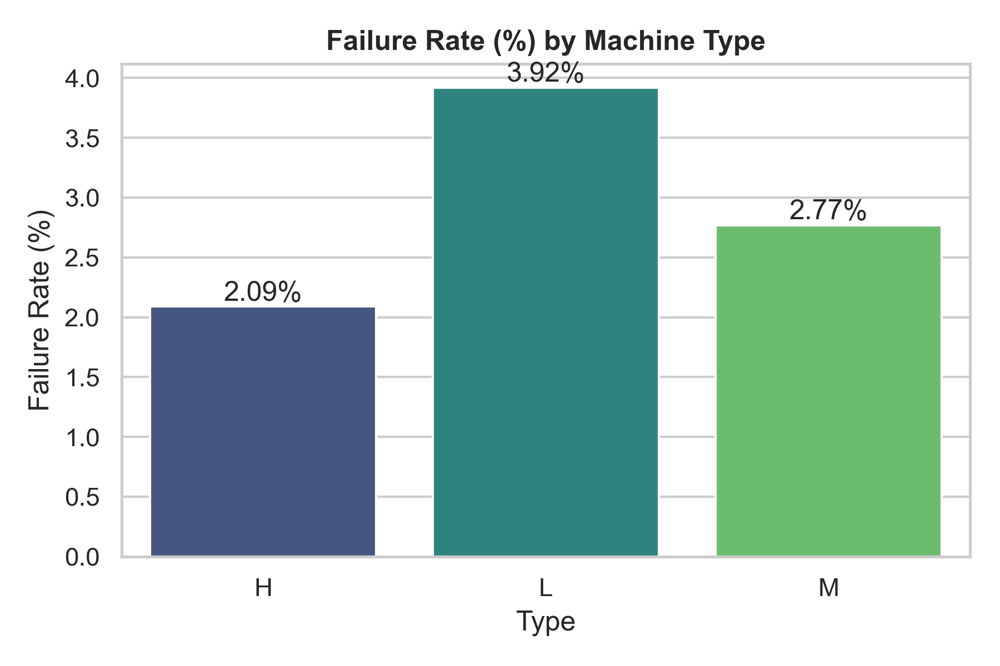
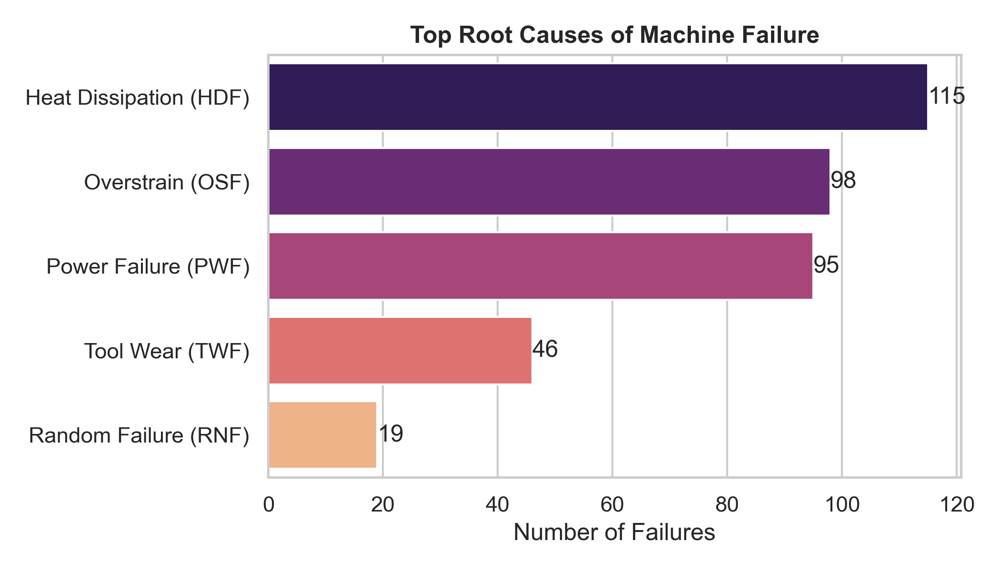

# Manufacturing Quality Control & Predictive Maintenance Analysis

## 📌 Project Overview
Equipment downtime and product defects directly impact factory output and maintenance costs. In this project, I analyzed **10,000 machine production logs** using **Python (Pandas, Matplotlib, Seaborn)** to identify the primary drivers of equipment failure and recommend preventive maintenance actions.

* **Tools Used:** Python, Pandas, Matplotlib, Seaborn, Jupyter Notebook
* **Dataset:** AI4I 2020 Predictive Maintenance Dataset (Kaggle)

---

## 🔍 Key Findings & Insights
* **Overall Failure Rate:** Out of **10,000 production runs**, **339 runs failed**, resulting in an overall failure rate of **3.39%**.
* **Machine Quality Impact:** Low-quality variant machines (**Type L**) experienced the highest failure rate at **3.92%**, nearly double that of high-grade machines (**Type H** at **2.09%**).
* **Primary Root Causes:** **Heat Dissipation Failure (`HDF`, 115 cases)** and **Overstrain Failure (`OSF`, 98 cases)** were the top two technical bottlenecks causing machine downtime.

---

## 📊 Visual Analysis

### 1. Failure Rate by Machine Quality Variant

### 2. Primary Root Causes of Machine Failure

---

## 💡 Business Recommendations
1. **Prioritize Preventive Maintenance on Type L Lines:** Schedule more frequent thermal and mechanical inspections on `Type L` machines to bring their 3.92% failure rate closer to `Type H` benchmarks.
2. **Improve Cooling & Thermal Monitoring:** Address Heat Dissipation (`HDF`) as the #1 failure mode by adding automated temperature alerts before machines reach critical heat thresholds.
3. **Enforce Tool Wear & Torque Limits:** Monitor tool wear and torque levels together to prevent Overstrain (`OSF`) breakdowns during heavy production runs.

---

## 📂 Files in This Repository
* `predictive_maintenance_analysis.ipynb` — Complete Python code for data cleaning, aggregation, and visualization.
* `ai4i2020.csv` — Raw dataset containing 10,000 production records.
* `chart1_failure_by_type.png` & `chart2_root_causes.png` — High-resolution charts generated from the analysis.
